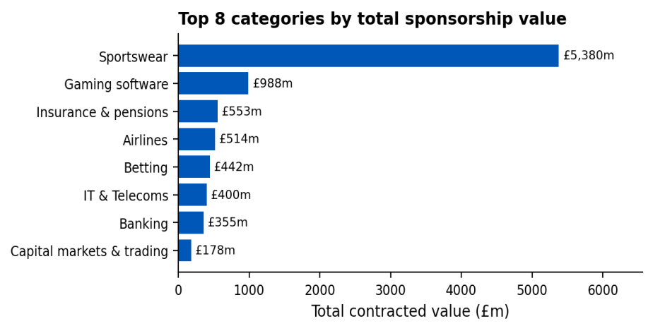
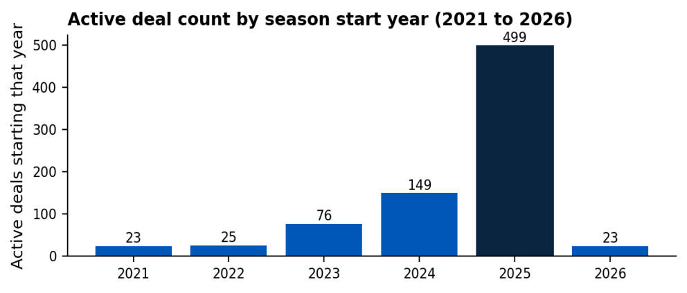
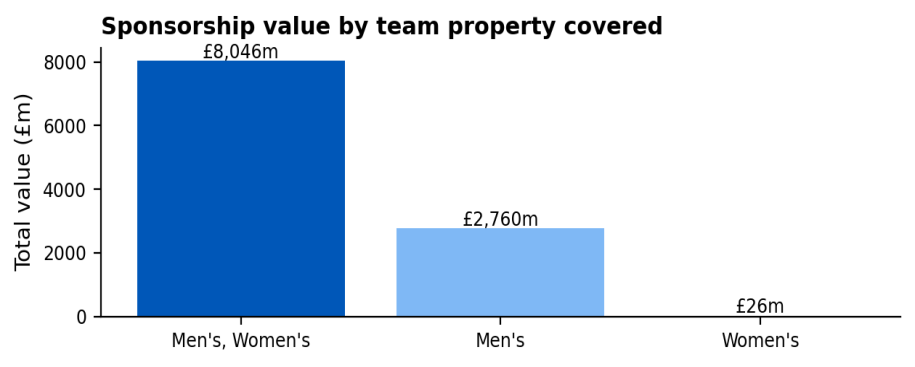
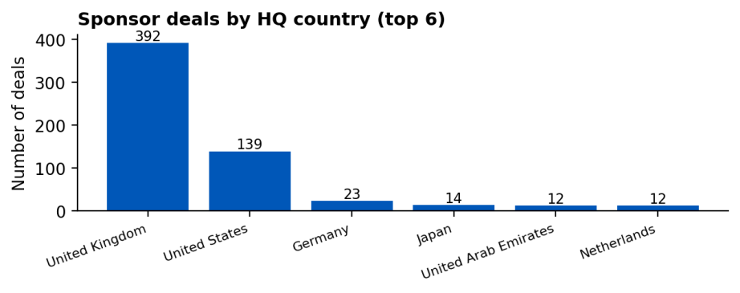

# Football Sponsorship Trends Analysis

## Overview

A commercial analysis case study on a UK football league (the Risers League). Harrington FC wants to grow its sponsorship portfolio, so the task was to find up to five commercial trends in the league's live sponsorship deals and recommend one category and one brand for a new category partnership (for example, Official Automotive Partner) for the 2026/27 season.

> Club names are fictional and deal values are simulated. Sponsor brands are real, but no figure here is a real contract value.

## Dataset

- 800 active sponsorship deals across men's and women's clubs, the League and the National Governing Bodies
- 14 fields per deal: sponsor, sponsor location, category, rights holder, team covered, sponsorship type, inventory, start/end dates, deal length, status and value
- Deal values range from £50k to £40bn, heavily right-skewed (median £500k, mean £63.5m)

## Data Cleaning (Excel / Google Sheets)

- Found one deal listed at £40bn, 40 times the next-largest deal and inconsistent with its category - treated as a data-entry error, excluded from value totals but kept and flagged in the workbook
- Mapped 201 category labels (many compound, e.g. "Computers & software; Internet & IT services") into 23 broader category groups
- Merged "Womens" into "Women's" so the gender split wasn't undercounted
- Converted deal dates into proper date values and pulled out a start year for trend analysis
- Separated Harrington FC's own 38 deals to compare its portfolio with the rest of the league

## Scoring Models

- **Deal Strength Score:** converted categorical fields (sponsorship type, sponsor inventory) into numeric scores, min-max normalised them, and combined them with deal length, deal value and time left to run into one weighted score per deal
- **Weighted Sum Model (WSM):** ranked the category groups across the 542 team deals held by league clubs, using median deal value (30%), sponsorship type (20%), deal length (20%), share of deals (20%) and time to end (10%)

| WSM Rank | Category group | Score |
|---|---|---|
| 1 | Sportswear & Equipment (kit deals, outside the brief) | 0.141 |
| 2 | **Betting & Gaming** | **0.094** |
| 3 | Financial Services | 0.077 |
| 4 | Technology & IT | 0.061 |

## Key Findings

1. **Kit deals dominate the money, not the deal count:** sportswear is only 4% of deals (33 of 799) but £5.38bn of £10.83bn total value

2. **Most deals are short-term:** 410 of 800 deals run for a single season, 62% started on 1 July 2025, and 78% end on 30 June 2026

3. **Betting has the most deals, mostly at low tiers:** 38 deals, 16 of them at entry-level Official Sponsor tier, averaging £11.6m. Betano (£50m with Kennedy FC) and Stake.com (£60m with Serrano FC) are the standout spenders
4. **The women's team's success isn't reflected in sponsorship yet:** women's-only deals total £26m across 20 deals, just 0.24% of league value

5. **Sponsors are mostly UK and US based:** 66% of deals combined, while only 40 deals (5%) come from Germany, France or Australia, where the club has opened youth academies

## Recommendation

| | |
|---|---|
| **Category** | Official Betting Partner, Major Partner tier |
| **Brand** | Betano |

- Harrington FC's current betting deal (Bet365, Official Sponsor, £11m) expires on 30 June 2026, so there is a natural point to upgrade
- Betano already pays £50m for a Major Partner deal at another league club, about four and a half times the club's current betting fee, and has the highest Deal Strength Score of the 46 betting deals held by league clubs
- Any deal should include UK gambling advertising safeguards and responsible gambling messaging, given the club's youth academies

## Files

| File | Description |
|---|---|
| [`Sponsorship_Trends_Report.pdf`](Sponsorship_Trends_Report.pdf) | Full report: trends, evaluation and recommendation |
| [`Sponsorship_Trends_Workbook.xlsx`](Sponsorship_Trends_Workbook.xlsx) | Raw data, cleaning audit trail, scoring tables, scored data, betting drill-down, WSM ranking and EDA pivots |

## Tools & Technologies

- Microsoft Excel / Google Sheets (data cleaning, pivot tables, lookups, scoring models)
- Weighted Sum Model (multi-criteria decision analysis)
